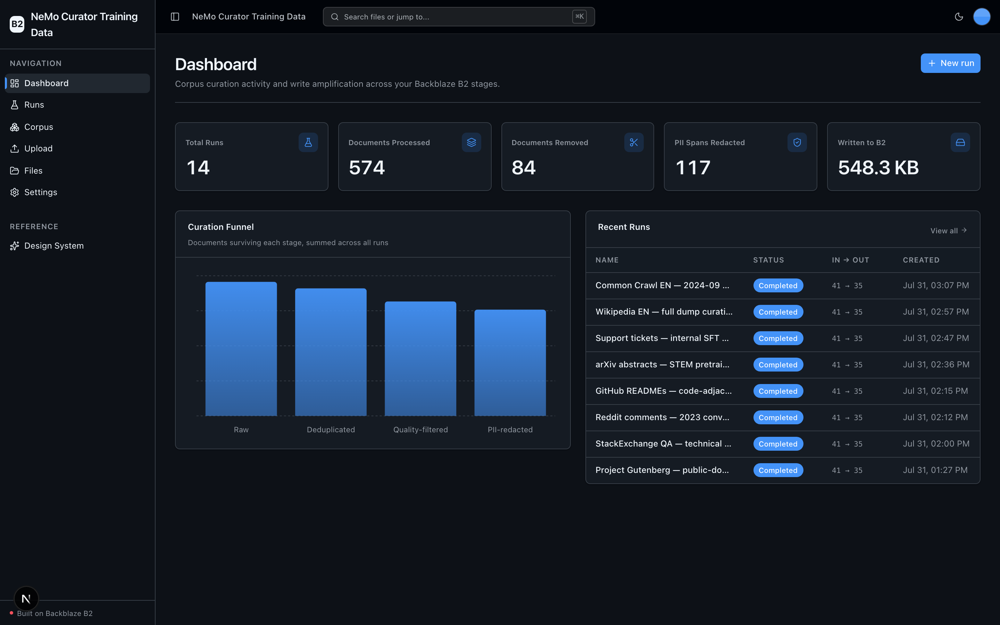
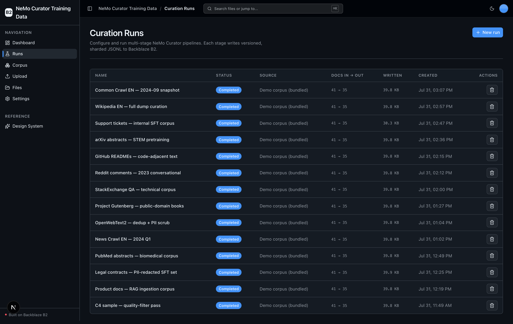
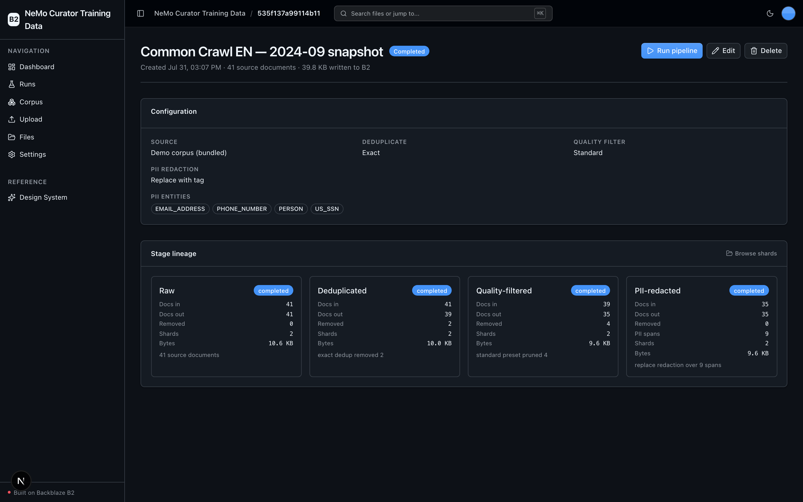
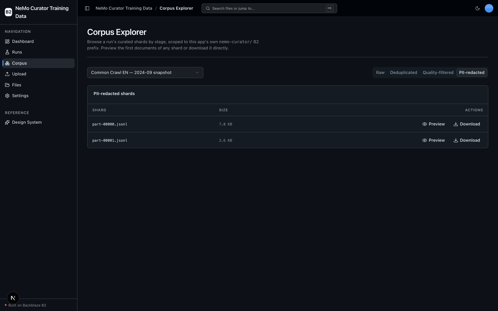
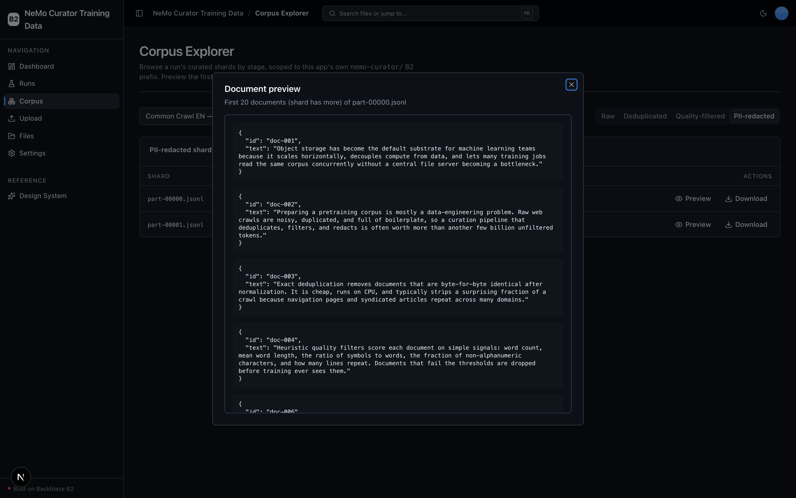
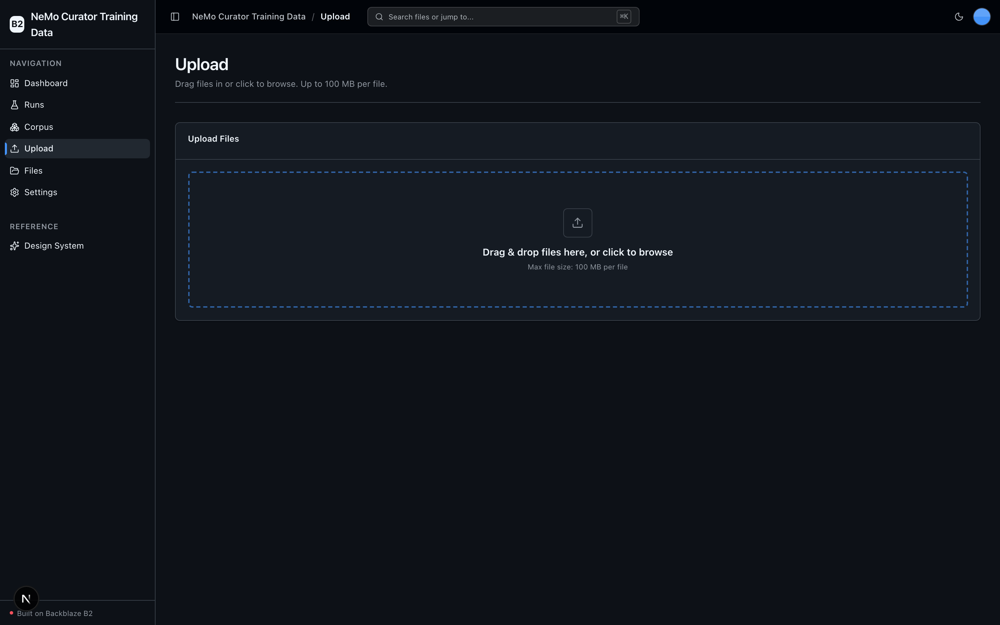

<!-- last_verified: 2026-07-31 -->
# NeMo Curator Training Data

Curate LLM pretraining / fine-tuning corpora with [NVIDIA NeMo Curator](https://github.com/NVIDIA/NeMo-Curator) and keep every stage versioned on **[Backblaze B2](https://www.backblaze.com/sign-up/ai-cloud-storage?utm_source=github&utm_medium=referral&utm_campaign=ai_artifacts&utm_content=b2ai-nemo-curator-training-data)**.

Point the app at a raw text dump (web crawl, scraped docs — the demo ships a tiny synthetic one, but the design targets multi-GB) and run it through a multi-stage curation pipeline — **deduplicate → quality-filter → PII-redact**. Each stage writes its own versioned, sharded JSONL set to B2, and a per-run `manifest.json` tracks lineage and per-stage stats. The output is an audit-ready, lineage-tracked corpus that a downstream training job pulls straight from B2.

The B2 story here is **write amplification on a data-heavy workload**: `raw + deduped + filtered + redacted` = up to 4× copies of the corpus land in B2, all via the **S3-compatible API** with a custom user-agent and standardized `B2_*` env vars. There is no second API key — NeMo Curator is local OSS, so you only need B2 credentials.

**What you get out of the box:**
- Curation runs — create, configure, run, inspect, edit, and delete a multi-stage pipeline over a raw corpus (the primary entity)
- Deduplication, quality filtering, and PII redaction — each a NeMo Curator stage whose output is a separately versioned, sharded JSONL set in B2
- Lineage & versioned B2 stages — a per-run manifest tracks docs-in/out and bytes written per stage (the write-amplification story)
- Corpus Explorer — browse a run's curated shards by stage, scoped to the app's own B2 prefix, with document preview and download
- A curation dashboard, a full-bucket File Explorer, and drag-and-drop Upload (stage a raw corpus into B2), all on a FastAPI + Next.js foundation with strict layered architecture and structural tests
- Agent-optimized docs — your AI coding agent can read the repo and start contributing immediately

## What it looks like

**Dashboard** — curation metrics (total runs, documents processed and removed, PII spans redacted, bytes written to B2), a per-stage curation funnel, and a recent-runs table.



**Curation Runs** — every multi-stage run listed with its status, source, documents in → out, bytes written to B2, and creation time.



**Run detail** — a single run's configuration and full stage lineage (raw → deduplicated → quality-filtered → PII-redacted), with per-stage documents, PII spans, shards, and bytes.



**Corpus Explorer** — browse a run's curated shards by pipeline stage, scoped to the app's own `nemo-curator/` B2 prefix, with per-shard preview and download.



**Document preview** — open any shard to inspect the first curated JSONL documents inline.



**Upload** — drag-and-drop a raw corpus into B2 to stage it as a run source.



## Agent-First Architecture

This repo is optimized for coding agents. The structure follows the principle that **repository knowledge is the system of record**. Anything an agent can't access in-context doesn't exist — so everything it needs to reason about the codebase is versioned, co-located, and discoverable from the repo itself.

### How it works

**[AGENTS.md](AGENTS.md) is the single source of truth for all coding agents.** Its bounded, agent-sized entry point gives agents the repository layout, architectural invariants, commands, conventions, and pointers to deeper docs. Agent-specific files (CLAUDE.md, GEMINI.md, Copilot instructions, etc.) are thin pointers back to AGENTS.md.

**Architecture is enforced mechanically, not by convention.** Layering rules, import boundaries, file size limits, and SDK containment are verified by structural tests and lints that run on every change. When rules are enforceable by code, agents follow them reliably.

**The knowledge base is structured for progressive disclosure:**

```
AGENTS.md              Single source of truth — layout, invariants, commands, conventions
ARCHITECTURE.md        System layout, layering rules, data flows
docs/
  features/            Feature docs (inputs, outputs, flows, edge cases)
  app-workflows.md     User journeys
  dev-workflows.md     Engineering workflows and testing
  SECURITY.md          Security principles
  RELIABILITY.md       Reliability expectations
  exec-plans/          Execution plans and tech debt tracker
```

### Key design decisions

| Principle | Implementation |
|-----------|---------------|
| Give agents a single source of truth | AGENTS.md — bounded layout, invariants, commands, conventions |
| Enforce invariants mechanically | Structural tests + ruff + ESLint verify boundaries |
| DRY documentation | Each fact lives in one place; no redundant files to drift |
| Strict layered architecture | `types -> config -> repo -> service -> runtime`, enforced by tests |
| Contain external SDKs | `boto3` and `nemo_curator` only in `repo/` — verified by structural test |
| Keep the build fast and green | The heavy curation engine is split out of the default lock (see below) |
| Keep files agent-sized | 300-line limit per file, enforced by test |
| Docs updated with code | Same-PR requirement prevents documentation rot |
| Structured observability | JSON logging, `/metrics` endpoint, request tracing |

This approach draws from [OpenAI's experience building with Codex](https://openai.com/index/harness-engineering/): agents work best in environments with strict boundaries, predictable structure, and progressive context disclosure.

## Quick Start

You need: Node.js >= 20, pnpm >= 9, Python >= 3.11, and a free **[Backblaze B2 account](https://www.backblaze.com/sign-up/ai-cloud-storage?utm_source=github&utm_medium=referral&utm_campaign=ai_artifacts&utm_content=b2ai-nemo-curator-training-data)**.

### Supported local environments

Local scripts are supported on macOS, Linux, and WSL2. Native Windows is not
supported yet because the dev scripts use POSIX shell syntax and
`services/api/.venv/bin/*` paths; use WSL2 on Windows.

Cloud or sandboxed coding-agent environments also need permission for dependency
downloads during `pnpm run setup`. Running the app or Playwright E2E requires
localhost server binding for the web server on port 3000 and the API on
8000-8009, plus permission to launch the Playwright Chromium browser. If a
sandbox denies binding, `pnpm run doctor` and `scripts/pick-port.mjs` report
`EPERM`/`EACCES` as a permissions issue instead of a busy port. A host without
IPv6 (many containers) is not treated as a failure — the IPv4 probe decides.

### Start a new project

```bash
git clone https://github.com/backblaze-b2-samples/nemo-curator-training-data.git my-cool-app
cd my-cool-app
rm -rf .git
git init
git add .
git commit -m "Initial commit from nemo-curator-training-data"
```

### Setup

**1. Run setup**

```bash
pnpm run setup
```

This copies `.env.example` to `.env` only when `.env` does not already exist,
installs workspace dependencies from `pnpm-lock.yaml`, creates
`services/api/.venv` if missing, and installs the API's committed Python 3.11
resolution from `services/api/requirements.lock`. It is safe to rerun and never
overwrites an existing `.env`.

> Use the `pnpm run` form: `setup` (like `doctor`) is a built-in pnpm command
> before pnpm 11, so bare `pnpm setup` would run pnpm's own command instead of
> this script.

**2. Add your B2 credentials**

Open `.env` in your editor and keep it visible. Then head to the [Backblaze B2 dashboard](https://secure.backblaze.com/b2_buckets.htm?utm_source=github&utm_medium=referral&utm_campaign=ai_artifacts&utm_content=b2ai-nemo-curator-training-data) and:

1. **Create a bucket.** Paste its details into `.env`:
   - **Bucket Unique Name** → `B2_BUCKET_NAME`
   - The **region** portion of the bucket's endpoint (e.g. `us-west-004`) → `B2_REGION`. The app derives the full S3 endpoint from the region as `https://s3.<B2_REGION>.backblazeb2.com`, so you never set a full endpoint URL.
2. **Create an application key** with `Read and Write` permission. B2 will show two values — paste each into `.env`:
   - **keyID** → `B2_APPLICATION_KEY_ID`
   - **applicationKey** → `B2_APPLICATION_KEY` *(only shown once — paste it now)*

> Want a walkthrough? See the docs for [creating a bucket](https://www.backblaze.com/docs/cloud-storage-create-and-manage-buckets?utm_source=github&utm_medium=referral&utm_campaign=ai_artifacts&utm_content=b2ai-nemo-curator-training-data) and [creating app keys](https://www.backblaze.com/docs/cloud-storage-create-and-manage-app-keys?utm_source=github&utm_medium=referral&utm_campaign=ai_artifacts&utm_content=b2ai-nemo-curator-training-data).

**3. (Optional but required to run a curation) Install the curation engine**

The app **boots, serves the UI, and browses B2 without this step** — you can create runs and explore the dashboard. But *executing* a curation run needs NVIDIA NeMo Curator, which is deliberately **split out of the default install**:

```bash
services/api/.venv/bin/pip install -r services/api/requirements-curator.txt
```

This installs NeMo Curator, spaCy + Presidio, Dask, and the `en_core_web_lg`
spaCy model (pinned to a reproducible release wheel — no separate
`spacy download` step; `en_core_web_lg` is Presidio's default NER model, so
pinning it avoids a ~560MB runtime download on the first curation). **Why the split?** NeMo Curator's dependency tree (Dask,
spaCy + Presidio, fasttext, justext, torch, …) is heavy and slow to resolve on
macOS arm64, so keeping it out of `requirements.lock` lets `pnpm run setup` and
the credential-free `pnpm verify` gate stay fast and green. `repo/curator.py`
lazy-imports `nemo_curator` inside its run function, so **without the engine the
app still runs and browses, and only `POST /runs/execute` fails the run** with a
clear message: *"curation engine not installed — run `pip install -r
services/api/requirements-curator.txt`"*. The engine is heavy to resolve locally;
a native `linux/arm64` container is an acceptable install path if macOS
resolution fails.

**4. Run it**

```bash
pnpm dev
```

That's it. Frontend at `localhost:3000`, API at `localhost:8000`. Create a run on
the **Runs** page (the "Demo corpus (bundled)" source needs no external data),
click **Run pipeline**, then watch the stages stream sharded JSONL into B2 and
browse them in the **Corpus Explorer**. Interactive API docs (Swagger UI) are at
`localhost:8000/docs`, with ReDoc at `/redoc`.

`pnpm dev` runs the preflight check first — it catches the common setup gotchas (wrong Node/Python version, missing venv, missing or placeholder `.env`, ports already taken) and tells you exactly how to fix each one. Run it standalone any time with `pnpm run doctor`.

## Building Your App

When you adapt this kit for a new app, keep the shared scaffolding and only swap out what's app-specific:

- **Keep** the UI kit (`apps/web/src/components/ui/` + design tokens in `globals.css` + `/design`).
- **Keep** the File Explorer (`/files`) and Upload (`/upload`) pages and their sidebar nav entries — they're the reusable B2-backed surface. Upload doubles as the way to stage a raw corpus into B2 for the `Uploaded B2 prefix` run source.
- **Adapt** the Dashboard (`/`) to your use case — this app already replaces the default file stats with corpus-curation metrics.
- **Rebrand** by editing a single file: `apps/web/src/lib/app-config.ts` holds the app name and description (`APP_NAME`, `APP_DESCRIPTION`).

Full contract and rationale: [AGENTS.md §2 — Building on This Starter Kit](AGENTS.md#2-building-on-this-starter-kit).

## Core Features

- [Curation Runs](docs/features/curation-runs.md) — create, configure, run, inspect, edit, and delete a multi-stage curation pipeline (the primary entity)
- [Deduplication](docs/features/deduplication.md) — NeMo Curator exact dedup removes duplicate documents; deduped shards written to B2
- [Quality Filtering](docs/features/quality-filtering.md) — heuristic filters (word count, mean word length, symbol ratio, non-alpha ratio, repeated lines) prune low-quality docs into a separate versioned stage
- [PII Redaction](docs/features/pii-redaction.md) — Presidio-backed detection + redaction of emails, phones, names, SSNs, cards, and IPs over spaCy `en_core_web_lg`
- [Lineage & Versioned B2 Stages](docs/features/lineage-and-b2-layout.md) — every stage is its own versioned sharded set under the run's prefix; the manifest tracks lineage + bytes written (the write-amplification story)
- [Corpus Explorer](docs/features/corpus-explorer.md) — browse a run's curated shards by stage, scoped to the app's B2 prefix, with document preview and download
- [Dashboard](docs/features/dashboard.md) — total runs, documents processed/removed, PII spans redacted, and total bytes written to B2, plus a per-stage funnel and recent-runs table
- [File Upload](docs/features/file-upload.md) — drag-and-drop upload (inherited starter surface; stages a raw corpus into B2)
- [File Browser](docs/features/file-browser.md) — full-bucket list, preview, download, delete (inherited starter surface)
- [Metadata Extraction](docs/features/metadata-extraction.md) — inherited starter capability (generic upload metadata), not a curation feature
- [Design System](docs/design-system.md) — tokens, primitives, AI elements, the blaze generating loader, and inline `ErrorState` / `EmptyState` patterns. Live preview at `/design`.

Plus the reusable starter plumbing: inline error handling with retry, single-source `.env` config validated at startup, a centralized TanStack Query data layer, a checked API contract (`docs/api/openapi.json` + `pnpm contract:check`), structural tests, structured JSON logging, `/health` and `/metrics` endpoints, `/docs` + `/redoc`, and per-IP rate limiting — see [SECURITY.md](docs/SECURITY.md).

## Tech Stack

- TypeScript, Next.js 16, React 19, Tailwind v4, shadcn/ui, Recharts
- TanStack Query — caching, dedup, retry, stale-while-revalidate for every fetch
- Python 3.11+, FastAPI, boto3, Pydantic v2, Pillow, PyPDF2 (light API stack, installed by `pnpm run setup`)
- **NVIDIA NeMo Curator** + Dask, spaCy `en_core_web_lg`, Presidio (`presidio-analyzer` / `presidio-anonymizer`) — the curation engine, installed on demand from `services/api/requirements-curator.txt`
- Backblaze B2 (S3-compatible object storage) — the sole data store; no application database
- pnpm workspaces (monorepo)

## Commands

| Command | What it does |
|---------|-------------|
| `pnpm run setup` | Idempotently copy `.env.example` to `.env` only if missing, install workspace dependencies, create the backend venv, and install the locked API dependencies |
| `pnpm run doctor` | Preflight environment check (also runs automatically before `pnpm dev`) |
| `pnpm dev` | Start frontend + backend |
| `pnpm dev:web` | Frontend only |
| `pnpm dev:api` | Backend only |
| `pnpm contract:export` | Export deterministic FastAPI OpenAPI JSON to `docs/api/openapi.json` |
| `pnpm contract:check` | Verify the checked-in OpenAPI artifact and frontend API client route registry |
| `pnpm check:agent-docs` | Validate agent shims, command docs, CI claims, and `.env` ignore coverage |
| `pnpm verify` | Credential-free canonical non-live pre-PR suite — runs `check:agent-docs`, `verify:api`, then `verify:web` |
| `pnpm verify:api` | Backend half: API lint, API tests, structure tests |
| `pnpm verify:web` | Frontend half: web lint, web unit tests, web typecheck + build |
| `pnpm verify:full` | `pnpm run doctor`, then `pnpm verify`, then Playwright E2E; requires populated `.env`, local server/browser permission, port 3000 free, and Chromium installed |
| `pnpm build` | Build frontend |
| `pnpm lint` | Lint frontend |
| `pnpm lint:api` | Lint backend (ruff) |
| `pnpm test:web` | Run frontend unit tests (vitest) |
| `pnpm test:api` | Run backend tests |
| `pnpm check:structure` | Verify layering rules |
| `pnpm test:e2e` | Playwright E2E smoke tests (run `pnpm --filter @nemo-curator-training-data/web exec playwright install chromium` once first) |

Run `pnpm run setup` once before local development, and rerun it after pulling
dependency changes. It installs the **light API stack** — the curation engine is
installed separately (see Setup step 3). If you add a Node dependency yourself,
run `pnpm install` to refresh `pnpm-lock.yaml`; for an API dependency, follow the
reviewed refresh workflow in
[docs/dev-workflows.md](docs/dev-workflows.md#python-dependency-updates). Run
`pnpm verify` before opening a PR; it needs `services/api/.venv` from setup but
neither B2 credentials nor the curation engine. Run `pnpm verify:full` when you
can start the local app stack and browser tests: `.env` must contain real B2
values, local server binding must be permitted, Playwright's Chromium browser
must be installed, and port 3000 must be free (or already serving this app).

`pnpm verify` needs neither B2 credentials nor a browser. For parallel agents,
use one Git worktree per verification run as documented in [the verification
workflow](docs/dev-workflows.md#non-live-verification). That page also covers
normal timing, slow-run recovery, and installing the optional local pre-commit
hooks.

## Documentation Map

| Doc | Purpose |
|-----|---------|
| [AGENTS.md](AGENTS.md) | Agent table of contents — start here |
| [ARCHITECTURE.md](ARCHITECTURE.md) | System layout, layering, data flows, the `nemo-curator/` B2 layout |
| [docs/features/](docs/features/) | Feature docs (curation runs, dedup, quality, PII, lineage, corpus explorer, plus inherited upload/browser/dashboard/metadata) |
| [docs/design-system.md](docs/design-system.md) | Design tokens, primitives, AI elements, loader, error/empty states |
| [docs/app-workflows.md](docs/app-workflows.md) | User journeys |
| [docs/dev-workflows.md](docs/dev-workflows.md) | Engineering workflows and testing |
| [docs/SECURITY.md](docs/SECURITY.md) | Security principles |
| [docs/RELIABILITY.md](docs/RELIABILITY.md) | Reliability expectations |
| [docs/exec-plans/](docs/exec-plans/) | Execution plans and tech debt tracker |

## Contributing

Start with [AGENTS.md](AGENTS.md). It's the map — everything else is discoverable from there. For local commit hooks, follow [the pre-commit workflow](docs/dev-workflows.md#pre-commit).

## License

MIT License - see [LICENSE](LICENSE) for details.

## Claude Agent B2 Skill

Manage Backblaze B2 from your terminal using natural language (list/search, audits, stale or large file detection, security checks, safe cleanup).

Repo: [https://github.com/backblaze-b2-samples/claude-skill-b2-cloud-storage](https://github.com/backblaze-b2-samples/claude-skill-b2-cloud-storage)
